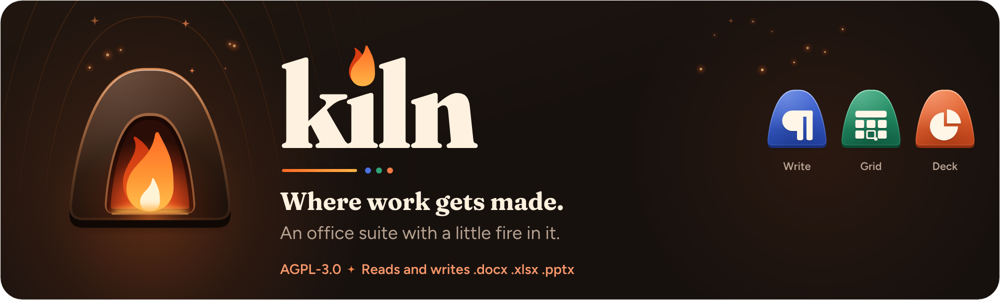

<p align="center">
  <picture>
    <source media="(prefers-color-scheme: dark)" srcset="docs/media/banner.png">
    <source media="(prefers-color-scheme: light)" srcset="docs/media/banner-light.png">
    
  </picture>
</p>

<p align="center">
  <a href="LICENSE"></a>
</p>

Kiln is an open-source office suite: a word processor (**Kiln Write**), a
spreadsheet (**Kiln Grid**) and a presentation editor (**Kiln Deck**), opened from
**Kiln Home**. It reads and writes Word, Excel and PowerPoint files directly, with a
ribbon, a File menu and Office's common shortcuts, on a Rust core that runs in the
browser and on Linux.

**Status.** Kiln runs in the browser, and you can build the desktop app for Linux from
source. There is no release to download. The test suite covers Linux and the browser.
The [site](https://zahakj.github.io/kiln/) and the
[manual](https://zahakj.github.io/kiln/manual/) describe what works, with measured
numbers; feature parity with Office is tracked row by row in [PARITY.md](PARITY.md).

## How it is built

Everything that computes (document models, layout, formulas, file formats,
collaboration, storage, PDF) is Rust, in one Cargo workspace of `kiln-*`
crates. Documents are laid out in Rust and painted onto a canvas from a display
list, and the PDF comes from the same layout. The same core
runs natively in the Tauri shell and as WebAssembly in a Web Worker for the web
app. The interface around the document (ribbon, dialogs, panes) is a thin
TypeScript and React layer with no business logic. [DESIGN.md](docs/DESIGN.md)
is the map of the code; the decisions are recorded in [docs/adr](docs/adr).

## Building

Rust 1.99.1 (pinned in `rust-toolchain.toml`), Node 24 and pnpm (pinned in
`package.json`). The setup scripts install everything in user space.

```sh
git clone https://github.com/ZahakJ/kiln && cd kiln
bash tools/setup-rust.sh && bash tools/setup-node.sh
source ~/.profile        # the tools the scripts installed
bash tools/verify-env.sh
pnpm install
cargo xtask wasm --release   # the web cores; `pnpm dev` needs them
cargo xtask verify       # rustfmt, Clippy with warnings denied, cargo-nextest
pnpm verify              # Biome, TypeScript, Vitest
pnpm dev                 # the web app on http://localhost:5173
pnpm e2e                 # Playwright end-to-end tests in headless Chromium
cargo run -p kiln-cli -- --version
```

The desktop shell needs the WebKitGTK development libraries on Linux
(`libwebkit2gtk-4.1-dev` and friends, listed in [Building from source](docs/manual/building.md));
then `pnpm tauri dev` opens it. Release bundles for Linux, Windows, macOS and
Android are built by the release workflow from a version tag
([RELEASING.md](docs/RELEASING.md)).

## Documentation

| | |
|---|---|
| [DESIGN.md](docs/DESIGN.md) | Architecture: crates, packages, runtime, threads, rendering |
| [FORMATS.md](docs/FORMATS.md) | What each file-format crate covers and the fidelity targets |
| [SHORTCUTS.md](docs/SHORTCUTS.md) | The Office keyboard shortcuts Kiln implements |
| [BRAND.md](brand/BRAND.md) | The brand: mark, app icons, colour, type, voice |
| [CONTRIBUTING.md](CONTRIBUTING.md) | Development loop, tests, code style |
| [SECURITY.md](SECURITY.md) | Reporting a vulnerability |
| [THIRD-PARTY-NOTICES.md](THIRD-PARTY-NOTICES.md) | Third-party components and their licences |

## Licence

GNU Affero General Public License, version 3 or later. See [LICENSE](LICENSE).
Every dependency is under a permissive licence (MIT, Apache-2.0, BSD, ISC,
MPL-2.0, Zlib, Unicode or OFL), checked by `cargo deny` and `pnpm licenses:check`.
