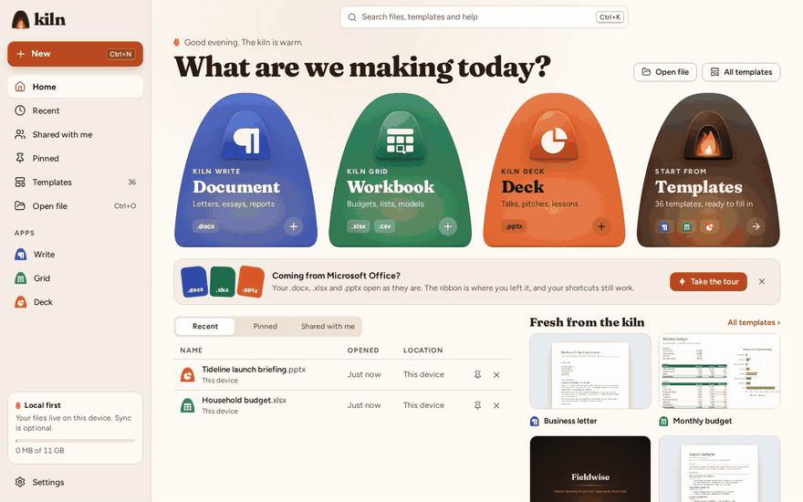
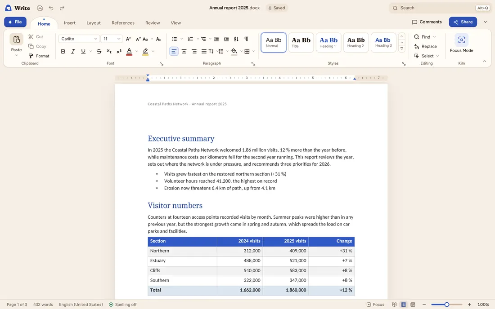
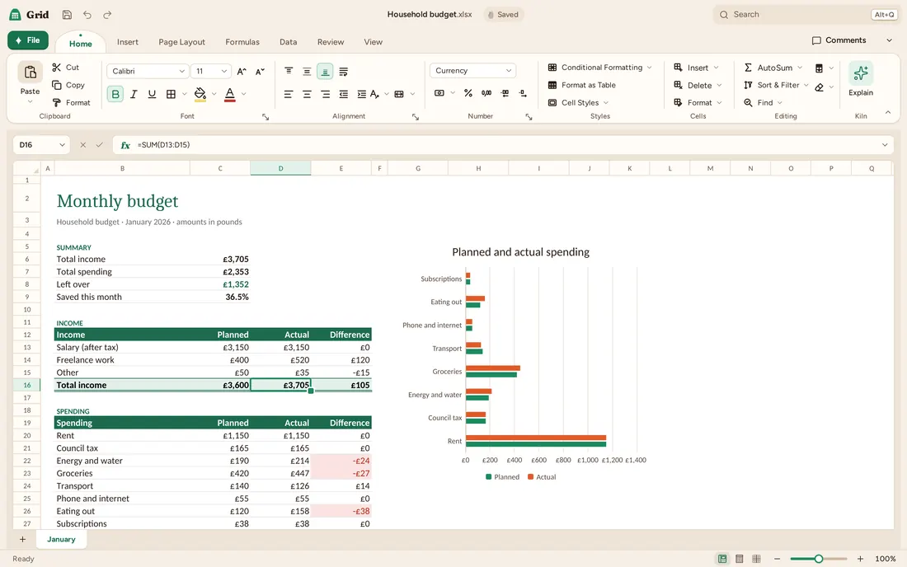
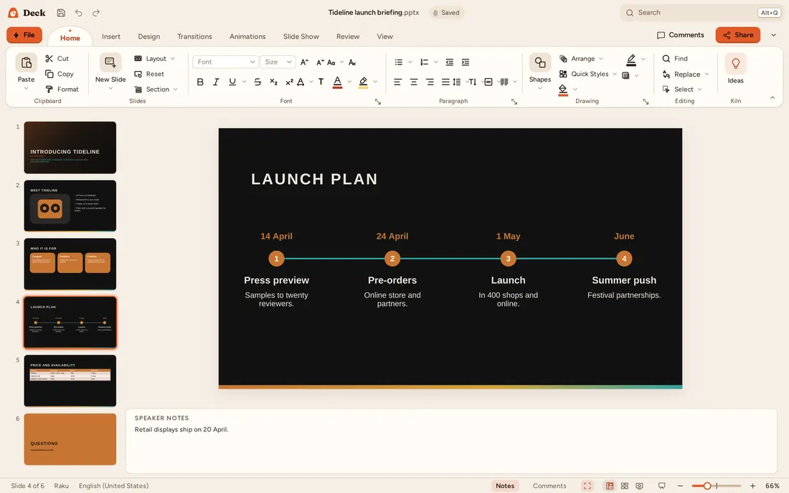
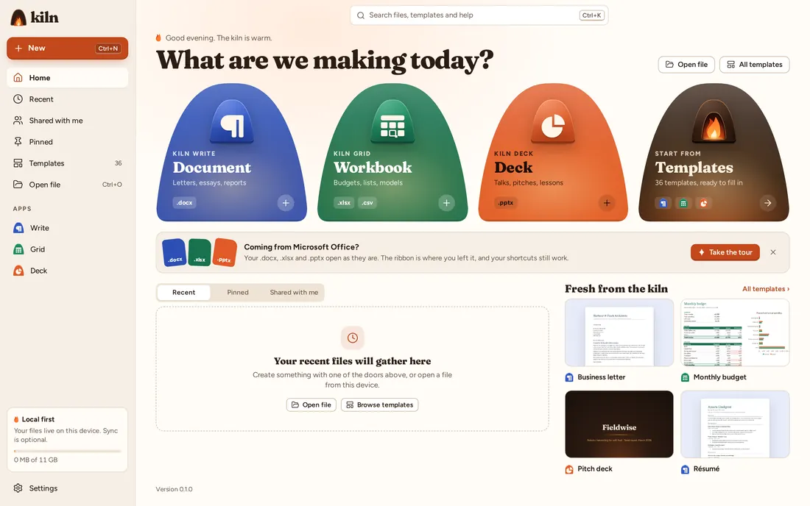

<p align="center">
  <picture>
    <source media="(prefers-color-scheme: dark)" srcset="docs/media/banner.png">
    <source media="(prefers-color-scheme: light)" srcset="docs/media/banner-light.png">
    
  </picture>
</p>

<h3 align="center">The office suite for your Word, Excel and PowerPoint files.</h3>

<p align="center">
  Write documents in <b>Kiln Write</b>, work out the numbers in <b>Kiln Grid</b> and present with <b>Kiln Deck</b>.<br>
  Your .docx, .xlsx and .pptx open as they are and save back the same way. Free, open source, no account.
</p>

<p align="center">
  <a href="https://zahakj.github.io/kiln/app/"><b>Open Kiln in your browser</b></a>
  &nbsp;·&nbsp;
  <a href="https://zahakj.github.io/kiln/">Website</a>
  &nbsp;·&nbsp;
  <a href="https://zahakj.github.io/kiln/manual/">Manual</a>
  &nbsp;·&nbsp;
  <a href="https://github.com/ZahakJ/kiln/discussions">Discussions</a>
</p>

<p align="center">
  <a href="https://github.com/ZahakJ/kiln/actions/workflows/ci.yml"></a>
  <a href="https://github.com/ZahakJ/kiln/actions/workflows/pages.yml"></a>
  <a href="LICENSE"></a>
  <a href="rust-toolchain.toml"></a>
</p>

<p align="center">
  
</p>

Kiln runs in your browser with nothing to install, keeps your documents on your device and
works offline once it has loaded. It is also a desktop app for Linux, Windows and macOS.

## Three apps

<table>
  <tr>
    <td width="50%">
      <picture>
        <source media="(prefers-color-scheme: dark)" srcset="docs/media/screenshots/write-report-dark-1100.webp">
        
      </picture>
    </td>
    <td width="50%">
      <picture>
        <source media="(prefers-color-scheme: dark)" srcset="docs/media/screenshots/grid-budget-dark-1100.webp">
        
      </picture>
    </td>
  </tr>
  <tr>
    <td valign="top"><b>Kiln Write</b>, in place of Word. Styles, sections, headers and footers,
    footnotes and tables of contents; Track Changes and threaded comments; version history; focus
    mode and word goals; laid out the same on screen, on paper and in PDF.</td>
    <td valign="top"><b>Kiln Grid</b>, in place of Excel. Formulas as you write them in Excel, with
    dynamic arrays and LAMBDA and <span data-stat="functions">505</span> functions; charts,
    PivotTables, conditional formatting, sort and filter; a Formula Lab that works a formula out
    step by step. A million-cell workbook opens in the browser in
    <span data-stat="perf.web">2.76 s</span>.</td>
  </tr>
  <tr>
    <td width="50%">
      <picture>
        <source media="(prefers-color-scheme: dark)" srcset="docs/media/screenshots/deck-launch-dark-1100.webp">
        
      </picture>
    </td>
    <td width="50%">
      <picture>
        <source media="(prefers-color-scheme: dark)" srcset="docs/media/screenshots/home-dark-1100.webp">
        
      </picture>
    </td>
  </tr>
  <tr>
    <td valign="top"><b>Kiln Deck</b>, in place of PowerPoint. Masters, layouts and themes from the
    .pptx; a slide show with Presenter View (notes, the next slide, a timer); transitions,
    animations and the Animation Pane; Design Ideas; handouts and notes pages in print and PDF.</td>
    <td valign="top"><b>Kiln Home</b> opens all three: new documents,
    <span data-stat="templates">36</span> finished templates and your recent files. The pictures
    follow your colour scheme; the <a href="https://zahakj.github.io/kiln/">website</a> shows both
    themes and the phone layout.</td>
  </tr>
</table>

## What it does

- **Opens and saves your Office files as they are.** `.docx`, `.xlsx` and `.pptx` with no import
  step, plus CSV, text and Markdown, and PDF from every app; the Linux app adds OpenDocument.
  Embedded objects, SmartArt and macros stay in the file through a save, and macros never run.
  Bundled fonts with the measurements of Calibri, Cambria, Arial, Times New Roman and Courier New
  keep line breaks where they were.
- **The layout you know.** Ribbon, File menu, status bar, Key Tips on Alt, Office's shortcuts
  ([the full list](docs/SHORTCUTS.md)) and a command palette (Ctrl+Shift+P) that finds a command
  by its name in Kiln or in Office.
- **Private.** Documents are laid out and saved on your device, in the browser as on the desktop.
  No account, no telemetry.
- **Offline and installable.** After the first visit the web app starts and saves without a
  connection. Chrome and Edge install it as an app with a window of its own, which your file
  manager offers for your documents.
- **On a phone.** Below 640 px wide Kiln has a phone layout, with a toolbar for the selection and
  the whole ribbon one tap away.
- **Edit together.** Kiln Write documents and Kiln Deck presentations are edited together, live,
  through a small relay you run yourself ([how](docs/manual/collaboration.md)), and keep a version
  history you can preview and restore.
- **<span data-stat="templates">36</span> templates** of finished documents, workbooks and decks.
- **<span data-stat="languages">3</span> interface languages.** English, German and Arabic, with
  a mirrored right-to-left interface and right-to-left documents and sheets.

## Using Kiln

- **In the browser:** <https://zahakj.github.io/kiln/app/>. Chrome and Edge offer
  **Install Kiln**, which gives Kiln a window of its own ([the manual](docs/manual/web.md)).
- **On the desktop:** [Kiln 0.1.0](https://github.com/ZahakJ/kiln/releases/tag/v0.1.0) for Linux
  (.deb or AppImage), Windows (installer or .msi) and macOS (Apple silicon or Intel), an early,
  unsigned build: Windows asks before it runs the installer, and macOS asks you to allow Kiln
  once. You can also [build it from source](docs/manual/building.md).

## Building from source

Rust 1.99.1 (pinned in `rust-toolchain.toml`), Node 24 and pnpm (pinned in `package.json`). The
setup scripts install everything in your home directory, without root.

```sh
git clone https://github.com/ZahakJ/kiln && cd kiln
bash tools/setup-rust.sh && bash tools/setup-node.sh
source ~/.profile            # the tools the scripts installed
bash tools/verify-env.sh     # says what is missing
pnpm install
cargo xtask wasm --release   # the web cores; `pnpm dev` needs them
pnpm dev                     # the web app on http://localhost:5173
```

Before a pull request: `cargo xtask verify` (rustfmt, Clippy with warnings denied,
cargo-nextest), `pnpm verify` (Biome, TypeScript, Vitest) and `pnpm e2e` (Playwright in headless
Chromium). The desktop shell needs the WebKitGTK development libraries on Linux, listed in
[Building from source](docs/manual/building.md); then `pnpm tauri dev` opens it.

## How it is built

Everything that computes (document models, layout, formulas, file formats, collaboration,
storage, PDF) is Rust, in one Cargo workspace of `kiln-*` crates. Documents are laid out in Rust
and painted onto a canvas from a display list, and the PDF comes from the same layout. The same
core runs natively in the Tauri shell and as WebAssembly in a Web Worker for the web app. The
interface around the document (ribbon, dialogs, panes) is a thin TypeScript and React layer with
no business logic.

| Document | What it covers |
|---|---|
| [DESIGN.md](docs/DESIGN.md) | Architecture: crates, packages, runtime, threads, rendering |
| [FORMATS.md](docs/FORMATS.md) | What each file-format crate covers and the fidelity targets |
| [docs/adr](docs/adr) | The architecture decisions |
| [docs/qa](docs/qa) | The test reports: round-trip fidelity, speed and the rest |
| [PARITY.md](PARITY.md) | Office features, row by row, and the test that covers each |
| [BRAND.md](brand/BRAND.md) | The brand: mark, app icons, colour, type, voice |
| [THIRD-PARTY-NOTICES.md](THIRD-PARTY-NOTICES.md) | Third-party components and their licences |

## Contributing

Bug reports with a file that shows the problem, feature requests and pull requests are welcome.
[CONTRIBUTING.md](CONTRIBUTING.md) has the development loop, the tests and the code style;
questions go to [Discussions](https://github.com/ZahakJ/kiln/discussions). Report a security
problem privately, as [SECURITY.md](SECURITY.md) describes. Everyone taking part follows the
[Code of Conduct](CODE_OF_CONDUCT.md).

## Licence

GNU Affero General Public License, version 3 or later: see [LICENSE](LICENSE). Every dependency
is under a permissive licence (MIT, Apache-2.0, BSD, ISC, MPL-2.0, Zlib, Unicode or OFL), checked
by `cargo deny` and `pnpm licenses:check`.
