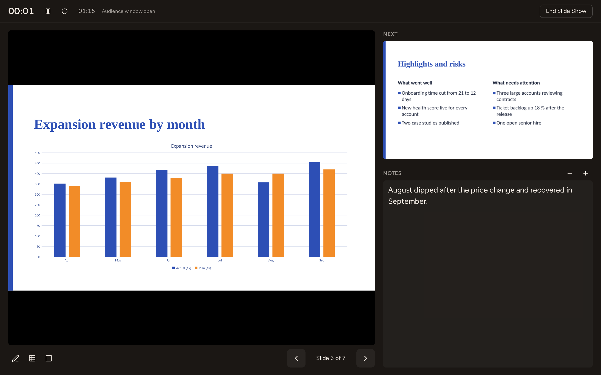

# Presenting with Kiln Deck

Kiln Deck plays slide shows itself: Kiln draws the transitions, animations, slide timings and the
pen, and keeps them in the `.pptx`.

## Transitions

**Transitions ▸ Transition to This Slide** sets how the selected slides come in: None, Fade,
Push, Wipe, Split, Reveal, Cut, Random Bars, Shape, Uncover, Cover and Flash.

- **Effect Options** lists the choices of the transition: the direction of Push, Wipe, Cover and
  Uncover (*From Bottom* moves the slides up), Vertical or Horizontal In or Out for Split, Smoothly
  or Through Black for Fade, Cut and Reveal, Circle, Diamond, Plus, In and Out for Shape.
- **Duration** is in seconds. **Apply To All** gives every slide this slide's transition and timing.
- **Advance Slide**: *On Mouse Click* lets a click move on; *After* moves on by itself after the
  seconds given (once the slide's animations have played).
- **Preview** plays the transition on the slide, from the slide before it.
- A star in the thumbnail rail marks slides with a transition or animations.

A slide with Morph from PowerPoint plays it as Fade and keeps it. A transition PowerPoint has and Kiln does not (Vortex, Curtains and
the like) plays as its nearest relative and is saved back as it was.

## Animations

Select a shape, then choose an effect in **Animations ▸ Animation** (it replaces the shape's
effect) or **Add Animation** (it adds one more):

- Entrance: Appear, Fade, Fly In, Float In, Split, Wipe, Zoom, Grow & Turn.
- Emphasis: Pulse, Colour Pulse, Teeter, Spin, Grow/Shrink.
- Exit: Disappear, Fade, Fly Out, Zoom.

**Effect Options** has the effect's direction or amount and, for a shape with several paragraphs,
**Sequence**: *As One Object*, *All at Once*, or *By Paragraph* (each paragraph on its own click).

**Timing**: *Start* (On Click, With Previous, After Previous), *Duration* and *Delay* in seconds,
and *Move Earlier* / *Move Later*. While the Animations tab is shown, each animated shape has its
click numbers beside it on the slide.

**Animation Pane** lists the slide's effects in order with their click number, start, shape and a
timeline. Click a row to select it (Ctrl and Shift add rows), drag rows to reorder them, use the
arrows or Alt+Up and Alt+Down to move them, Delete to remove them, and **Play** to see them.

**Animation Painter** picks up the selected shape's effects; the next shape you click gets them.

## Slide Show

- **From Beginning** (F5) and **From Current Slide** (Shift+F5) show the presentation full screen.
- **Present in Browser Tab** shows it in the tab, without going full screen.
- **Reading View** (View, or the status bar) plays it inside the window from the current slide,
  with Previous and Next in the status bar; Esc goes back to the view you were in.
- A **PowerPoint Show** (`.ppsx`) starts its show as soon as it opens.
- **Set Up Slide Show**: the show type (presented by a speaker, browsed in a window, or at a kiosk,
  which loops and only advances by slide timings), loop until Esc, without narration, without
  animation, all slides or a range, advance manually or with timings, and Use Presenter View. The
  settings are saved in the presentation, where PowerPoint keeps them, except Use Presenter View:
  the file format has no place for it, so turning it on or off does not change the presentation.
- **Hide Slide** leaves the selected slides out of the show; typing a hidden slide's number and
  Enter still shows it.
- **Rehearse Timings** shows the presentation with a timer. At the end Kiln asks whether to keep
  the time of each slide as its *After* timing.
- **Use Presenter View**: the show opens in a second window for the audience, and this window
  shows Presenter View.

### During the show

| Key | What it does |
|---|---|
| N, Space, Right, Page Down, Enter, click | Next animation or slide |
| P, Backspace, Left, Page Up | Previous animation or slide |
| a slide number, then Enter | Go to that slide |
| Home / End | First / last slide |
| B / W | Black / white screen (again to come back) |
| Ctrl+L | Laser pointer |
| Ctrl+P / Ctrl+I | Pen / highlighter |
| Ctrl+E / E | Eraser / erase all ink on the slide |
| Ctrl+A | Arrow (clicks advance again) |
| Esc | End the show |

On a touch screen, tap the left third of the slide to go back and anywhere else to go on.

The toolbar at the bottom left (it fades after a few seconds without the mouse) has Previous,
Next, the pen and laser tools, **See All Slides** and End Show. After the last slide comes a black
screen, *End of slide show, click to exit.*

Ink stays on its slide until the show ends.

Video and audio on a slide play when you click them, without moving the show on; a video shows
its playback controls once it plays and stops at its trim.

### Presenter View

Presenter View shows the slide the audience sees, the next slide, the speaker notes (with buttons
to make the text larger or smaller), a timer you can pause and restart, the time of day, and
*Slide 3 of 12*. The keys of the show work here, and the pen, laser, black screen, See All Slides
and End Slide Show are in its toolbar. Whatever you do in either window, the other follows.

In the browser, Presenter View opens the audience's show in a new window: drag it to the projector
and press F11 there for full screen. If the browser blocks the window, allow pop-ups for Kiln and
start again.

## Handouts and notes pages

To hand out the presentation, use **File ▸ Print** or **Export ▸ Export as PDF** with **Handouts**
(1 to 9 slides a page; three a page leave lines for notes) or **Notes Pages** (each slide with its
speaker notes). See [Printing and exporting](deck.md#printing-and-exporting).
