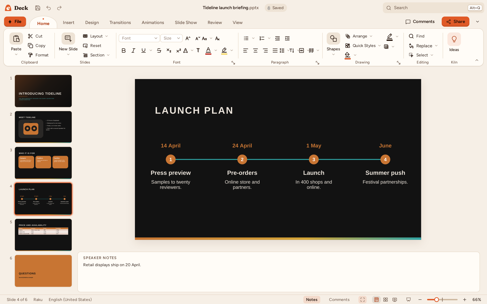

# Kiln Deck

Kiln Deck is the presentation app of Kiln. It opens and saves PowerPoint presentations (`.pptx`,
`.pptm`, `.potx`, `.ppsx`). Parts of the file Kiln does not model are copied back byte for byte; the
parts it models are written again, with your edits. The ribbon, the shortcuts and the dialogs follow
PowerPoint; the slides are drawn by Kiln itself.

## The window

- **Ribbon**: Home, Insert, Design, Transitions, Animations, Slide Show, Review and View, with
  PowerPoint's groups. **Drawing Tools ▸ Shape Format** appears while a shape is selected,
  **Picture Tools ▸ Picture Format** with a picture and **Table Tools** with a table.
- **Thumbnail rail** (left): every slide, numbered. The current slide has a ring in the Deck colour;
  hidden slides are dimmed with their number struck through. Sections are headers you can collapse.
- **Stage** (middle): the current slide on the pasteboard, zoomed to fit the window.
- **Notes** (under the stage): the current slide's speaker notes. **View ▸ Notes** or the Notes
  button in the status bar shows and hides the pane.
- **Status bar**: *Slide 3 of 12* (*Slide Master* in Slide Master view), the theme, the language,
  Notes and Comments, the Normal, Slide Sorter and Reading views, **Slide Show**, the zoom, and
  **Fit Slide to Current Window**, which fits the slide again.

On a phone the slide takes the width, the notes the space under it, and the rail becomes a strip of
thumbnails at the bottom.

## Slides

- **New Slide** (Ctrl+M) adds a slide after the current one with the layout PowerPoint would pick
  (Title and Content after a title slide). The arrow under New Slide lists the layouts.
- **Layout** changes the layout of the selected slides and keeps their text. **Reset** puts moved or
  resized placeholders back where the layout has them.
- **Duplicate** (Ctrl+D in the rail), **Delete** (Delete in the rail) and **Hide Slide** (right-click
  a thumbnail) act on the selected slides.
- Drag thumbnails to reorder them; Shift+click and Ctrl+click select several, and dragging moves all
  of them. In the rail, the arrows go through the slides and Enter or Ctrl+Enter adds one.
- **Section ▸ Add Section** starts a section at the current slide. Right-click a section header to
  rename, remove (with or without its slides) or move it.
- **View ▸ Slide Sorter** shows every slide in rows: drag to reorder, double-click to open.
- **View ▸ Outline View** shows the text of every slide in the rail's place: each slide's number and
  title, then its bullets. Type in any line; the slide follows. Enter starts a line (in a title, a
  new slide with the rest of the title and the lines after it), Tab demotes a line (a title becomes a
  bullet of the slide before, and its slide goes), Shift+Tab promotes it (a first-level bullet
  becomes a new slide), Backspace at the start of a line joins it to the line before. When the slide
  that would go has pictures, other shapes or speaker notes, Kiln asks first. Click
  **Outline View** again, or **Normal**, for the thumbnails.
- **Reuse Slides** (Home ▸ New Slide, Insert): browse to another presentation, then click a slide
  to insert it after the current one, or **Insert All Slides**. Reused slides take this
  presentation's layouts and theme; their pictures, backgrounds, video, charts and animations come
  with them (comments stay behind).

## Text

Click a placeholder or a text box and type. A placeholder shows its prompt (*Click to add title*)
until it has text, in the interface language (*Titel durch Klicken hinzufügen*, *انقر لإضافة عنوان*);
the prompt is never saved, printed or shown in the slide show.

- The arrows, Home and End, Ctrl+arrows (by word and paragraph), Shift to select, Backspace and
  Delete (Ctrl for a word) work as in PowerPoint. Enter starts a paragraph, Shift+Enter breaks the
  line, Tab at the start of a bullet demotes it and Shift+Tab promotes it (also Alt+Shift+Right and
  Left). Esc ends the edit with the shape selected.
- Typing with a shape selected replaces its text. Double-click selects a word (and starts editing a
  shape's text), triple-click the paragraph.
- **Font** and **Paragraph** (the ↘ launchers of Home ▸ Font and Paragraph, or the context menu) set
  the font, style, size, colour, underline, effects and spacing, and the alignment, line spacing and
  list level, in one go.
- **Insert ▸ Symbol**: pick a font and a subset (common symbols, arrows, maths, shapes), click a
  symbol, or type its Unicode character code (`2192` for →) and click Insert. It goes in at the
  caret, or in a new text box when nothing is being edited.
- **F4** repeats the last formatting, arranging or inserting on the new selection.
- **Home ▸ Font**: font, size, grow and shrink, bold, italic, underline, strikethrough, shadow,
  character spacing (Very Tight to Very Loose, or any amount with *More Spacing…*), change case
  (Shift+F3), subscript and superscript, colour and highlight.
- **Home ▸ Paragraph**: bullets and numbering from the master's list styles, indent, alignment
  (Ctrl+L, E, R, J), line spacing, text direction, vertical alignment (Align Text) and columns.
  **Convert to List Diagram** turns the selected list into grouped shapes, one per first-level item
  with its sub-items inside: *Basic Block List*, *Basic Process* (boxes joined by arrows) or
  *Vertical Bullet List*. They are ordinary shapes, so they open the same in any app.
- **Paste** (Ctrl+V) keeps the copied formatting; Paste ▾ and the context menu also have *Use
  Destination Theme*, **Picture** (what was copied, as a PNG, where it was) and *Keep Text Only*;
  **Paste Special** has the same choices.
- **Shape Format ▸ Text ▸ Autofit**: *Shrink Text on Overflow*, as PowerPoint does it (the size is
  worked out when you stop typing and saved with the file), or *Resize Shape to Fit Text*.
- **Home ▸ Editing ▸ Find** (Ctrl+F) and **Replace** (Ctrl+H) search every slide and the notes;
  **Replace ▸ Replace Fonts** swaps one font for another everywhere.

## Shapes, pictures and tables

- **Shapes**: pick a shape from **Home ▸ Drawing ▸ Shapes** or **Insert ▸ Shapes** (*All Shapes…*
  has every PowerPoint shape by category), then drag on the slide to draw it. A click places it at
  its default size; Shift keeps the proportions. Text typed into a shape is centred.
- **Text Box**: Insert ▸ Text Box, then click or drag on the slide and type.
- **Pictures**: Insert ▸ Pictures (PNG, JPEG, GIF, BMP, WebP). A selected picture placeholder takes
  the picture. Picture Format has Reset Picture, Alt Text and **Crop**: black crop handles appear on
  the picture; drag them to crop, drag inside the frame to move the picture behind it (the part
  cropped away shows faintly), and press Esc or click elsewhere when done. Crop ▾ has **Crop to
  Shape**, **Aspect Ratio** (square, portrait and landscape), **Fill** (the picture covers the frame)
  and **Fit** (all of the picture in the frame), and *Crop by Values…* for exact percentages.
- **Icons** (Insert ▸ Illustrations): search or browse about 150 line icons, pick one or several and
  click Insert. Each icon is a shape: **Shape Outline** changes its colour and weight.
- **Code Block** (Insert ▸ Kiln): paste or type code and choose the language; it goes on the slide
  in a shaded box in Consolas with its keywords, strings, numbers and comments coloured. It is
  ordinary formatted text, so PowerPoint shows it the same way.
- **Tables**: Insert ▸ Table, then the rows and columns. A new table, chart or picture takes the place
  of the slide's empty content placeholder, or goes where it covers the least. Tab moves to the next
  cell (a new row after the last one), Shift+Tab to the previous one. Table Design and Layout appear
  while the caret is in the table. Drag across cells, or Shift+click, to select several:
  **Merge Cells**, **Split Cells** (columns and rows), **Cell Margins** (Normal, None, Narrow, Wide
  or Custom), the alignments, Shading, Borders and Delete act on them.
- **Charts**: Insert ▸ Chart, then the type (column, bar, line, area, pie, doughnut, scatter,
  bubble, combo, treemap, sunburst, radar). The chart starts with sample data in a sheet saved
  inside the presentation; **Chart Design ▸ Edit Data** opens it: change values, names, rows and
  series and the chart follows. A chart from PowerPoint keeps its workbook: only the cells you change
  are written, every other cell keeps its formula and format, rows and columns keep their height,
  width and hidden state, and hidden rows are not plotted. A value typed over a formula replaces
  it, as in Excel, and Excel recalculates the workbook's other formulas when it opens it. A number
  typed as a percentage (`12%`) is one in the chart and the workbook. When the workbook is one Kiln
  cannot open (an `.xls` workbook, a linked file), Edit Data says so and leaves it as it is.
  Chart Design and Format have the styles, colours, layouts, elements
  and the Format pane, as in Kiln Grid. A chart takes its slide's theme: on a dark slide its labels,
  title and gridlines are light.
- **Header & Footer**: the date, slide number and footer, on this slide or all of them, not on
  title slides if you wish. Insert ▸ Slide Number puts a slide number field in the text.
- **Link** (Ctrl+K) links text or a shape to a web page, an existing file (a path next to the
  presentation; *Browse…* picks its name), a slide of the presentation or an e-mail address. In a
  browser a link to a file cannot open it; the desktop app does.
- **Lines and connectors**: drawn from Shapes ▸ Lines, a line's ends attach to the connection sites
  they land on (the sites show as you draw); attached connectors follow the shapes when they move.
  Drag an end to another site to attach it there, or away to free it.
- **Video** and **Audio** (Insert ▸ Media): the clip is saved in the presentation; a video shows its
  first frame on the slide and audio a speaker icon. In the slide show a click on the clip plays or
  pauses it.
- **Equation** (Insert ▸ Symbols): type the equation in the linear form (`a^2+b^2=c^2`,
  `x=(-b\pm\sqrt(b^2-4ac))/(2a)`, `\sum_(i=1)^n i`); it goes in at the caret, or in a new text box,
  and is saved as Office Math. Equations are shown in their linear form (`a²+b²=c²`).

### Moving, resizing and rotating

- Drag a shape to move it. **Smart guides** appear when its edges or centre line up with the slide's
  centre or edges, with other shapes, or when it sits at the same distance as its neighbours, and it
  snaps to them; hold **Alt** to move freely. **Shift** keeps the move horizontal or vertical,
  **Ctrl** drags a copy.
- Drag one of the eight **handles** to resize (Shift keeps the proportions, Ctrl resizes from the
  centre); drag the round handle above the shape to **rotate** (Shift turns in 15° steps).
- With a shape selected, the arrows nudge it by a grid step and Ctrl+arrows by a pixel; Shift+arrows
  resize it. Tab selects the next shape, Delete deletes the selection, Ctrl+D duplicates it.
- Drag on an empty part of the slide to select the shapes inside the rectangle; Ctrl+A selects all.
- **Arrange** (Home ▸ Drawing, and Shape Format): Bring to Front, Send to Back, Group (Ctrl+Shift+G),
  Ungroup (Ctrl+Shift+H), Align and Distribute, Rotate and Flip, and the **Selection Pane**, which
  lists the slide's shapes top first.
- **Shape Format ▸ Size**: the height and width in points; the corner launcher opens **Size and
  Position** with the position, rotation and Lock aspect ratio.
- **Quick Styles**, **Shape Fill**, **Shape Outline** (colour, weight, dashes, arrows) and **Shape
  Effects** (shadow, glow, soft edges) style the selected shapes from the theme. **Format Shape**
  (the ↘ of Home ▸ Drawing and Shape Format ▸ Shape Styles, or the context menu) fills with no
  fill, a colour with transparency, a gradient, a picture or a pattern; it opens on the selection's
  own kind of fill.
- The **Format Painter** (Home ▸ Clipboard ▸ Format, or Ctrl+Shift+C and Ctrl+Shift+V) copies the
  look of a shape or of text to the next one you click.

## Design

- **Design Ideas** (Design ▸ Designer, or Home): the Designer pane shows layouts for the current
  slide made from what it holds — a title band, a side panel, an accent bar, the title on the left,
  a statement, the picture on one side, across the top or filling the slide — and a dark variant,
  each drawn as it would look. Click one to apply it; Ctrl+Z undoes it, and picking another replaces
  it. The ideas are worked out by Kiln on your computer, with no account or online service.
- **Themes**: twelve Kiln themes (Kiln, Tenmoku, Cobalt, Jade, Saffron, Celadon, Shino, Raku,
  Porcelain, Slate, Terracotta, Ash). **Browse for Themes** takes a theme file (`.thmx`) or the
  master of another presentation or template.
- **Variants**: each theme's four variants, drawn on the current slide. The Variants menus change
  the **Colors** (Office's palettes, Grayscale and the bundled themes'), **Fonts**, **Effects** and
  **Background Styles** (PowerPoint's twelve, light and dark) on their own.
- **Slide Size**: Standard (4:3), Widescreen (16:9) or a custom size; content is scaled down to fit
  (*Ensure Fit*) or to fill the new size (*Maximize*).
- **Format Background**: a solid colour with transparency, a gradient, a picture or a pattern, for
  this slide or all of them; **Reset Background** goes back to the layout's; **Hide background
  graphics** hides the master's pictures and shapes on the slide.

## Review

- **Comments**: Insert ▸ Comment or Review ▸ New Comment (Ctrl+Alt+M) starts a thread on the
  selected object, or on the slide, in the Comments pane. Reply, edit, resolve and delete threads;
  **Previous** and **Next** go through them across the slides, and **Delete** removes one, all on
  the slide or all in the presentation. A marker beside the object shows each thread. Comments are
  saved as PowerPoint's.
- **Spelling** (F7): the Spelling pane goes through every slide and its notes from the current one,
  with suggestions, **Change**, **Change All**, **Ignore**, **Ignore All** and **Add to
  Dictionary**. Words to ignore and your own dictionary are kept by Kiln.

## View

- **Normal**, **Outline View**, **Slide Sorter**, **Notes Page** and **Reading View**. Notes Page
  shows the slide above its notes as they print; type into the notes in place, and Page Up and Page
  Down go through the slides. Reading View plays the show in the window from the current slide, with
  Previous and Next in the status bar; Esc goes back.
- **Slide Master**: the master and its layouts in the rail; edit them like slides and the slides
  that use them follow. **Insert Slide Master**, **Insert Layout**, **Delete**, **Rename**,
  **Preserve**, **Insert Placeholder** (content, text, picture, chart, table, media) and the
  **Title** and **Footers** check boxes; **Close Master View** goes back. New layouts are in New
  Slide and Layout.
- **Ruler** (View ▸ Show) counts from the middle of the slide in the measurement unit of
  File ▸ Options; while you type, its markers show and set the paragraph's indents.
- **Gridlines** and **Guides** help line shapes up. Drag a guide to move it (its position shows),
  Ctrl+drag to copy it, drag it off the slide to remove it; right-click the slide for **Grid and
  Guides ▸ Add Vertical Guide** or **Add Horizontal Guide**. Shapes snap to the guides, which are
  saved with the presentation.
- **Macros**: a presentation with macros (`.pptm`) opens and keeps them, but Kiln never runs them;
  View ▸ Macros says so. Save As `.pptm` keeps them; saving as `.pptx` asks first.
- **PowerPoint Show** (`.ppsx`): opens straight into the slide show; Esc leaves it in Normal view.
  Save As offers PowerPoint Show.
- **Zoom**: View ▸ Zoom, the status bar, or Ctrl+wheel over the slide. A zoom you choose stays until
  you pick **Fit to Window**. While the whole slide is in view, the wheel goes through the slides.

## Printing and exporting

- **File ▸ Print** and **File ▸ Export ▸ Export as PDF** print the slides, **Notes Pages** (the
  slide with its speaker notes under it), the **Outline**, or **Handouts** with 1, 2, 3, 4, 6 or 9
  slides on a page (in rows, or in columns with *Vertical*; three per page come with lines for notes
  beside each slide). **Slides** takes slide numbers (`1-3, 5`); **Frame Slides** draws a thin border
  round each slide; hidden slides print only with **Print Hidden Slides**. The PDF has real,
  searchable text, a bookmark for every slide and tags for screen readers.
- **File ▸ Export ▸ Export slides as pictures**: PNG or JPEG, 1280, 1920 or 3840 px wide, the
  current slide (*Just This One*) or every slide (a `.zip` with a folder of `Slide1.png`,
  `Slide2.png` …).
- From the command line: `kiln-cli convert talk.pptx talk.pdf --handouts 3` (or `--notes`,
  `--outline`; `--slides 1-3`, `--frame`, `--hidden`, `--vertical`), and `kiln-cli render talk.pptx
  --png out/` for one PNG per slide.

## Shortcuts

Every shortcut in the Deck column of [the shortcut table](../SHORTCUTS.md) works on the stage. Press
Ctrl+/ for the cheat sheet. The keys of the slide show are in [Presenting](deck-present.md).
