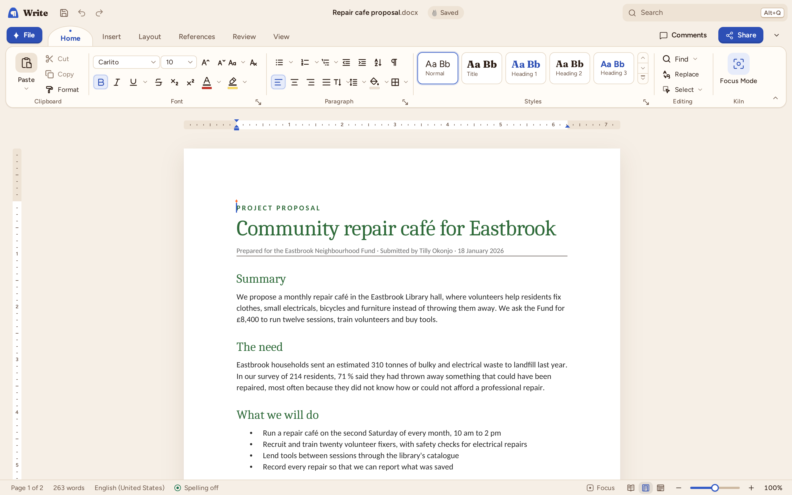
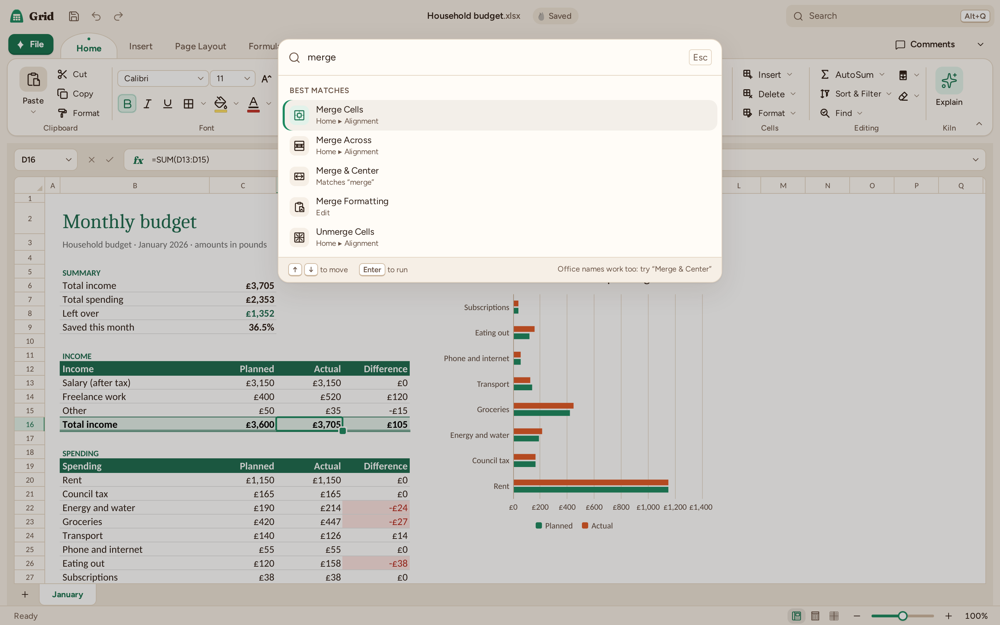

# Getting started

Kiln opens on **Kiln Home**. Choose a door to start a blank document, workbook or deck, pick one of the templates, or select **Open file** (Ctrl+O). Word, Excel and PowerPoint files open directly, with no import step.

## The window

- **The title bar** has the app's name, Save, Undo and Redo, the document's name and whether it is saved, and **Search** (Alt+Q).
- **The File button**, in the app's colour, opens the File menu: New, Open, Info, Save, Save As, Print, Share, Export and Options.
- **The ribbon** has Home, Insert, Layout, References, Review and View in Kiln Write; Home, Insert, Page Layout, Formulas, Data, Review and View in Kiln Grid; and Home, Insert, Design, Transitions, Animations, Slide Show, Review and View in Kiln Deck. Ctrl+F1 collapses it, and it comes in a classic and a simplified layout.
- **The status bar** shows the page and word count in Kiln Write, the sum and average of the selection in Kiln Grid and the slide number in Kiln Deck, with the views and the zoom on the right.

On a phone the window is laid out differently: see [Kiln on a phone or tablet](mobile.md).

## Finding a command

Three ways, all from the keyboard if you like:

- **The command palette** (Ctrl+Shift+P or Alt+Q) searches the commands by their name in Kiln or by the name Office gives them. Type "merge" or "format painter" and press Enter.

  

- **Key Tips**: press Alt and the ribbon shows a letter on every tab and button.
- **The cheat sheet**: Ctrl+/ lists the shortcuts of the app you are in. All of them are in [Keyboard shortcuts](shortcuts.md).

## Saving

Ctrl+S saves. A file you opened goes back to where it came from, in its own format; a new document asks for a name and a format (F12 is Save As at any time). Kiln keeps a recovery copy as you work, and AutoSave and version history are in [Files, AutoSave and recovery](files.md).

## Light, dark and language

Kiln follows the system's light or dark theme. **File ▸ Options** sets the theme, the [interface language](languages.md) and everything else: see [Options](options.md).

## Coming from Office

Three things are good to know on the first day:

- Macros in a file are kept when you save it, and Kiln does not run them.
- Kiln Grid's functions keep Excel's names in every language.
- Before you send a file back to someone on Office, **File ▸ Info ▸ Check for Issues** runs the Compatibility Checker.
