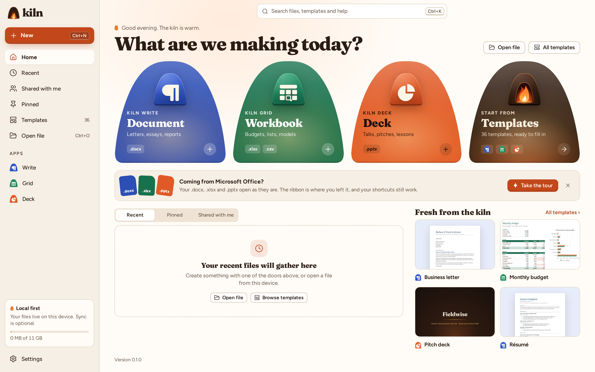

# Kiln Home and templates

Kiln Home is the start screen: it opens when Kiln starts without a file, and **Kiln Home** in the title bar of every window goes back to it. From here you create documents, start from a template, open files and find the ones you used last.

## Creating

- The doors **Document** (Kiln Write), **Workbook** (Kiln Grid) and **Deck** (Kiln Deck) each make a new, empty document in their app. The fourth door, **Templates**, opens the template gallery.
- **New** at the top of the left rail lists the same three blank documents.
- **Open file** (Ctrl+O) opens a file from this device: Word, Excel and PowerPoint files, OpenDocument files in the desktop app, CSV, and Kiln's own `.kwrite`, `.kgrid` and `.kdeck`.

## Templates

Kiln comes with 36 templates, twelve for each app. Each one is a finished document with real content, set in the fonts that come with Kiln, so it looks the same on every computer. Grid templates calculate: change a figure and the totals, rates and charts follow.

Choosing a template opens its app on a **new, untitled document** with the template's content (Document1, Book1, Presentation1). The template itself is never changed: **Save** asks where to keep your copy and in which format.

There are three ways to the templates:

- **Fresh from the kiln** on Kiln Home shows the featured templates; **All templates ›** opens the gallery.
- **Templates** in the left rail (on a phone, the **Templates** tab) and the **Templates** door open the gallery.
- **File ▸ New** in any app shows the same gallery, with that app's blank document first; **File ▸ Home** shows a blank document and the featured templates above your recent files.

In the gallery, type in **Search templates** to find a template by its name or what it is for ("invoice", "loan", "lesson"); the buttons **Documents**, **Workbooks** and **Presentations** show one app's templates (select one again, or **All**, to show every app). **Start blank** is always first.

| Kiln Write | Kiln Grid | Kiln Deck |
|---|---|---|
| Business letter | Monthly budget | Pitch deck |
| Résumé | Project tracker | Quarterly review |
| Annual report | Loan calculator | Business review |
| Invoice | Invoice | Lesson |
| Newsletter | Weekly schedule | Portfolio |
| Meeting notes | Gradebook | Product roadmap |
| Project proposal | Expense report | Project kickoff |
| Cover letter | Stock inventory | Workshop |
| Memo | Sales report | Product launch |
| Press release | Timesheet | All-hands |
| Research paper | Savings goals | Conference talk |
| Recipe | Travel planner | Case study |

## Your files

The list under the doors has three tabs:

- **Recent**: the files you opened or saved last, newest first, with where they are and when you opened them. Select a file to open it in its app. **Pin** keeps a file at the top; **Remove from list** takes it off the list (the file itself stays where it is).
- **Pinned**: the files you pinned.
- **Shared with me**: documents other people shared with you through a Kiln collaboration server. Open the link someone sent you once, and the document is listed here from then on, with the server it is shared through; select it to join it again. See [Collaboration and version history](collaboration.md).

The apps under **Apps** in the left rail show one app's files at a time; select the app again, or the chip above the list, to show every app.

## Search

The search box at the top (Ctrl+K) looks through your files and every template at once: the list shows the files whose name or folder matches, and beside it the matching templates, featured or not. Escape clears the search.

## The welcome tour

The first time Kiln Home opens, a short tour of three cards appears at the bottom of the window: what Kiln keeps of your Office files, where the ribbon and shortcuts are, and where to start. **Next** and **Back** (or the Left and Right arrow keys) move between the cards; **Skip tour**, the close button or Escape put it away. It does not come back on its own: **Take the tour** on the **Coming from Microsoft Office?** banner shows it again.

## Keyboard

Everything on Kiln Home works from the keyboard:

| Keys | What they do |
|---|---|
| Tab, Shift+Tab | Move through the tour (when it is shown), the rail, the search box, the doors, the lists and the templates |
| Ctrl+K | Go to the search box |
| Ctrl+O | Open a file |
| Up, Down | Move between the files of the list |
| Left, Right, Up, Down | Move between the template cards (in Arabic, Left and Right follow the reading order) |
| Home, End | The first or last file or template |
| Enter or Space | Open the file, create the document or open the template |
| Left, Right | In the list tabs, move between Recent, Pinned and Shared with me |

## On a phone

On a phone Kiln Home shows the doors two by two, the recent files under them, a **New** button above the bottom tabs (**Home**, **Files**, **Shared**, **Templates**), and Search and Settings at the top.
