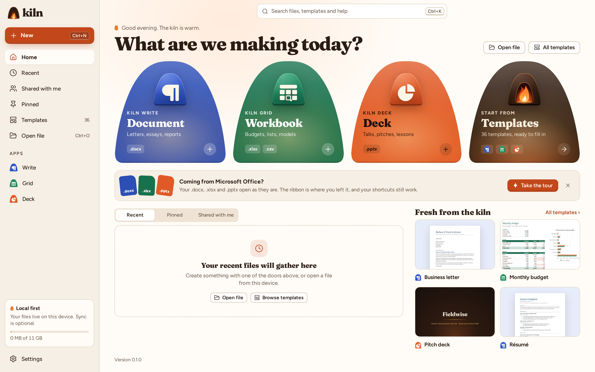

# The Kiln manual

Kiln is a free, open-source office suite: **Kiln Write** for documents, **Kiln Grid** for spreadsheets and **Kiln Deck** for presentations, opened from **Kiln Home**. It reads and writes Word, Excel and PowerPoint files directly, with a ribbon, a File menu and Office's common shortcuts.

## Start here

- [Getting started](getting-started.md): the window, opening and saving, finding a command
- [Kiln in the browser](web.md): use Kiln with nothing installed, online or offline
- [Kiln on Linux](install-desktop.md): build the desktop app from source
- [Keyboard shortcuts](shortcuts.md) and the [function list](functions.md)

## The applications

- [Kiln Write](write.md), with [reviewing](write-review.md) and [references and page furniture](write-layout.md)
- [Kiln Grid](grid.md), with [data](grid-data.md), [formulas](grid-formulas.md), [analysis](grid-analysis.md) and [charts](charts.md)
- [Kiln Deck](deck.md), with [presenting](deck-present.md)

Every page is in the [contents](README.md).
