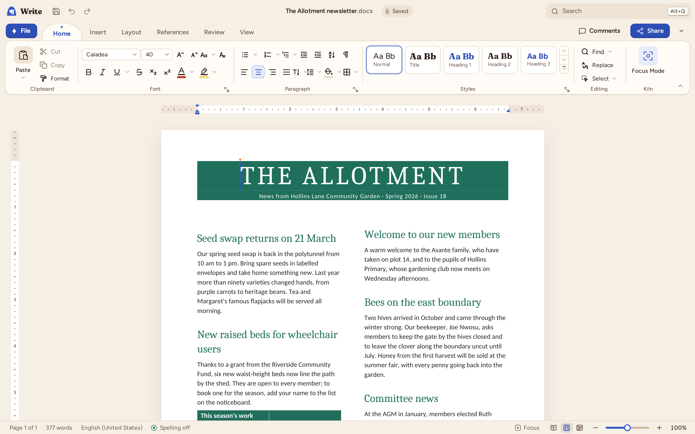

# Kiln Write

Kiln Write is the word processor of Kiln. It opens and saves Word documents (`.docx`, `.dotx`,
`.docm`). Parts of the file Kiln does not model are copied back byte for byte; the parts it models are
written again, with your edits. The ribbon, the shortcuts and the dialogs follow Word; the page is
laid out by Kiln itself, on screen, in print and in PDF.

## The window

- **Title bar**: Save, Undo and Redo beside the document name; the search box (Alt+Q) finds any
  command, also by its Word name ("Format Painter", "Show/Hide ¶").
- **Ribbon**: Home, Insert, Layout, References, Review and View, with Word's groups. The dialog
  launcher ↘ in a group's corner opens its dialog (Font, Paragraph, Page Setup, Styles). Table
  Design and Table Layout appear while the caret is in a table, Header & Footer while you edit one,
  Picture Format or Shape Format while a picture, shape or text box is selected.
- **Rulers**: above and left of the page (View ▸ Ruler turns them on and off).
- **Navigation pane** (View ▸ Navigation Pane, or Ctrl+F): search the document, browse its headings
  and pages, and jump there. Above the headings, Kiln lists headings that skip a level (a Heading
  3 straight after a Heading 1) and empty headings, which screen readers and tagged PDFs trip
  over; click one to go to it.
- **Styles pane** (Home ▸ Styles ↘): every style with a preview.
- **Status bar**: the page you are on and the page count (click for Go To), the word count (click
  for Word Count), the language, the views and the zoom slider. Right-click the status bar to choose
  what it shows (the character count and Track Changes are there, hidden by default, as in Word).

After a command from the ribbon, one of its menus or the status bar, the next key you press types in
the document, as in Word.

## Typing and selecting

Type as in Word. Kiln's text input works with every keyboard and input method, including Japanese,
Chinese and Korean IMEs: the text you are composing is shown underlined in the page until you
commit it.

| To | Press |
|---|---|
| Move by word / paragraph | Ctrl+Left, Ctrl+Right / Ctrl+Up, Ctrl+Down |
| Go to the start or end of the line / document | Home, End / Ctrl+Home, Ctrl+End |
| Extend the selection | add Shift to any of the above |
| Select everything | Ctrl+A |
| Select a word / a paragraph | double-click / triple-click |
| Delete the word before / after the caret | Ctrl+Backspace / Ctrl+Delete |
| New line in the same paragraph | Shift+Enter |
| Page break / column break | Ctrl+Enter / Ctrl+Shift+Enter |
| Undo / Redo / Repeat | Ctrl+Z / Ctrl+Y (or Ctrl+Shift+Z) / F4 |

In a right-to-left paragraph (Arabic, Hebrew) Left and Right follow the text's direction: Left moves
on through the text, which on the screen is to the left; Ctrl+Left moves to the next word. The caret
moves in the order of the text and is drawn where its position shows, so inside an English word of
an Arabic sentence it moves right. Where text of the two directions meets, a position touches both,
and Word's two carets show: the caret at the edge of the next character and a short second caret at
the end of the previous one. Home and End go to the start (the right end) and the end of the line;
Backspace and Delete remove the character before and after the position in the text; Shift with the
arrows selects in the order of the text, so a selection across a change of direction shows in two
pieces. A click puts the caret at the nearer edge of the character under the pointer.

Home ▸ Paragraph ▸ Text Direction (Alt, H, TD) makes the selected paragraphs run right to left or left to right.
Right-to-left paragraphs start at the right margin. Align Left and Align Right name the sides of the
page; a Word file stores them as the paragraph's end and start, and Kiln reads them as Word does.
List numbers sit at the right, read right to left (".1"), in the paragraph's Arabic font. A table
marked right to left in Word (`bidiVisual`) has its first column at the right. Arabic letters join and
form ligatures, and their marks sit over and under them, in the bundled Noto Naskh Arabic font.

Undo works in Word's steps: typing undoes a word at a time, and each formatting command is a step
of its own. Enter after a heading starts a paragraph in the heading's "next" style; Enter on an
empty list item ends the list.

**Drag and drop**: drag selected text to move it; a dotted caret shows where it will go. Hold Ctrl
while you drop to copy it instead. One Ctrl+Z puts it back.

**AutoCorrect** fixes common typing slips as you type, as Word does: "teh" becomes "the", "(c)"
becomes ©, "->" becomes →, the first letter of a sentence and the names of days get capitals, and
TWo INitial CApitals are corrected; " -- " between words becomes an en dash. Web addresses, email
addresses and file paths are left as typed. Ctrl+Z straight after a correction undoes it. **File ▸ Options ▸
Proofing ▸ AutoCorrect** turns each rule on or off and holds the replace-as-you-type list: add your
own entries (Replace "kln" With "Kiln"), and delete any of the built-in ones.

When you select text with the mouse, the **mini toolbar** appears above it with the font, the size,
bold, italic, underline, highlight, font colour and lists. Right-click shows it with the context
menu: Cut, Copy, the paste options, Font…, Paragraph…, Link…, and in a table the table commands.

## The clipboard

Copy and Cut put the selection on the clipboard as Kiln's own rich format, as HTML (for other
applications) and as plain text. Paste (Ctrl+V) keeps the source formatting; **Home ▸ Paste ▾**
offers Keep Source Formatting, Merge Formatting (the text takes the formatting where you paste it)
and Keep Text Only, and **Paste Special…** (Ctrl+Alt+V) lets you choose what to paste as: Kiln
formatted text, HTML Format, text matching the destination, Unformatted Unicode Text, Markdown (as
styled text) or, with a picture on the clipboard, the picture. A picture copied on its own (a
screenshot) pastes with Ctrl+V as a picture in the line. HTML from a web page or
another program is cleaned up by Kiln (scripts, styles and anything unsafe are dropped) and becomes
paragraphs, headings, lists, links and tables.

## Character formatting

Home ▸ Font: font, size, Grow Font (Ctrl+Shift+> or Ctrl+]) and Shrink Font (Ctrl+Shift+< or Ctrl+[),
Change Case (Shift+F3 cycles UPPERCASE, lowercase and Capitalize Each Word), Clear Formatting,
**bold** (Ctrl+B), *italic* (Ctrl+I), underline (Ctrl+U; double underline Ctrl+Shift+D; more kinds in
the menu and in the Font dialog), strikethrough, subscript (Ctrl+=), superscript (Ctrl+Shift+=),
highlight and font colour. Ctrl+Shift+A is All Caps; Ctrl+Space clears character formatting and
Ctrl+Q paragraph formatting.

With nothing selected, a formatting command applies to the word the caret is in, or, between words,
to what you type next — as in Word. Bold turns off only when the whole selection is already bold.

The **Font** dialog (Ctrl+Shift+F or Ctrl+D) has every option at once: font, style, size, colour,
underline style, strikethrough, double strikethrough, superscript, subscript, small caps, all caps,
hidden, and on the Advanced tab the scale, spacing and position of the characters.

## Paragraphs

Home ▸ Paragraph: bullets (Ctrl+Shift+L), numbering, multilevel lists, Decrease/Increase Indent
(Ctrl+Shift+M / Ctrl+M), Show/Hide ¶ (Ctrl+Shift+8), alignment (Ctrl+L, Ctrl+E, Ctrl+R, Ctrl+J),
line spacing (Ctrl+1 single, Ctrl+5 one and a half, Ctrl+2 double, and the menu's presets), shading
and borders. Alt+Shift+Up and Alt+Shift+Down move the paragraph; Alt+Shift+Left and Right promote
and demote a heading or list item.

The **Paragraph** dialog sets alignment, outline level, indents (left, right, first line or
hanging), spacing before and after, line spacing (single, 1.5, double, at least, exactly,
multiple), "Don't add space between paragraphs of the same style", and on the Line and Page Breaks
tab widow/orphan control, keep with next, keep lines together and page break before. **Tabs…**
lists the paragraph's tab stops with their alignment and leader.

The ruler shows the indents and tab stops of the paragraph with the caret. It, the ribbon's boxes and
the dialogs measure in one unit: inches in the US and centimetres elsewhere, or the one chosen in
**File ▸ Options ▸ Display ▸ Show measurements in units of**.

- drag the top triangle for the first-line indent, the bottom triangle for a hanging indent, the
  square under it for the whole left indent, and the right triangle for the right indent;
- click in the ruler to add a left tab stop; drag a tab stop to move it, or off the ruler to remove it;
- drag the edge between the grey margin and the white text area to change the page margins (the
  vertical ruler does the top and bottom margins);
- double-click the ruler for the Tabs dialog.

## Lists

Bullets and Numbering apply Word's lists; their menus offer other bullets and number styles, and
Multilevel List the 1 / a / i list or legal numbering (1.1.1). Tab and Shift+Tab at the start of a
list item change its level (Tab moves to the next cell in a table instead). A list continues the
list just above it; right-click ▸ **Restart at 1** and **Continue Numbering** change that. Typing
"1. " or "- " at the start of a paragraph starts a list (one of the [Markdown
shortcuts](write-review.md#markdown-shortcuts-and-smart-typography), which you can turn off).

## Styles

The Home gallery and the Styles pane show Word's built-in styles (Normal, No Spacing, Heading 1–3,
Title, Subtitle, Emphasis, Strong, Quote, Intense Quote, List Paragraph…) plus the document's own.
Click to apply; Ctrl+Alt+1, 2 and 3 apply the headings and Ctrl+Shift+N Normal. In the Styles pane,
each style's menu has **Update to Match Selection** and **Modify…**, and **New Style** makes a style
from the selection's formatting.

## Tables

**Insert ▸ Table** shows Word's grid: move over it (or use the arrow keys) and click (or press Enter)
to insert a table of that size. **Insert Table…** asks for the size and the AutoFit behaviour, and
**Convert Text to Table** turns tab-separated lines into a table.

In a table, Tab moves to the next cell and adds a row at the end; Shift+Tab goes back. **Table
Layout** inserts rows above or below and columns left or right, deletes cells, rows, columns or the
table, merges and splits cells, splits the table, sets cell size, distributes rows and columns,
aligns the cell contents, repeats header rows and converts the table to text. **Table Design** sets
the table style, the header row, total row, banded rows and columns options, shading and borders.

**Table Layout ▸ Properties** opens **Table Properties**: on the Table tab the preferred width (in
centimetres or per cent), alignment, indent, text wrapping around the table and the default cell
margins and spacing; on the Row tab the row height (at least or exactly), "Allow row to break across
pages" and "Repeat as header row"; on the Column and Cell tabs the widths and the vertical alignment
of the text; and on the Alt Text tab a title and a description. **Sort** (Home ▸ Paragraph, or Table
Layout ▸ Data) sorts the table's rows or the selected paragraphs by text, number or date, ascending
or descending, with or without a header row.

Tables can sit in a table cell: put the caret in a cell and insert a table there. Kiln shows and
edits nested tables as Word does.

## Pages and sections

**Layout ▸ Page Setup**: margins (Normal, Narrow, Moderate, Wide, Mirrored or custom), orientation,
size (Letter, Legal, Executive, A3, A4, A5, B5, Tabloid or custom), columns, and **Breaks** (page,
column, text wrapping, and section breaks: next page, continuous, even page, odd page). The Page
Setup dialog sets all of these at once, for the section with the caret or for the whole document.
Insert ▸ Blank Page adds an empty page.

## Headers, footers and page numbers

**Insert ▸ Header** or **Footer** (or a double-click in the top or bottom margin) edits the header or
footer of the section; the body is dimmed and the Header & Footer tab offers Different First Page,
Different Odd & Even Pages, Link to Previous, and under Position the **Header from Top** and **Footer
from Bottom** distances. Press Esc or **Close Header and Footer** to return
to the body. **Page Number** puts a PAGE field at the top or bottom of the page, left, centre or right.

## Links, bookmarks, symbols, dates and fields

- **Link** (Ctrl+K): a web address, an e-mail address or a bookmark in the document, with the text
  to show and a ScreenTip. Kiln refuses `javascript:` and other unsafe addresses.
- **Bookmark**: names the selection; Go To and links can jump to it.
- **Symbol**: common symbols by subset; the symbol fonts (Symbol, Wingdings, Wingdings 2 and 3,
  Webdings), whose characters are saved as Word's symbol characters so Word shows the same glyph;
  your recently used symbols; and any Unicode character by its code. In the text, type a code such
  as 2603 and press **Alt+X** to turn it into ☃ (Alt+X again turns it back).
- **Date & Time**: the formats Word offers, as text or as a field that updates (F9 updates fields;
  Ctrl+; and Ctrl+Shift+; insert today's date and the time).
- **Pictures ▸ This Device**: inserts a PNG, JPEG, GIF, BMP or WebP picture in the line.

## Find, Replace and Go To

Type in the Navigation pane's search box (Ctrl+F) to list every match with its page; Enter and
Shift+Enter step through them. **Replace** (Ctrl+H) opens Find and Replace; **More** shows Match
case, Find whole words only, Use wildcards (Word's: `?`, `*`, `<`, `>`, `[ ]`, `{n,m}`, `@`) and
regular expressions, and special characters such as `^p` (paragraph mark) and `^t` (tab). Replace All
is one step to undo. **Go To** (Ctrl+G or F5) jumps to a page, section, line, bookmark or heading;
`+2` or `-1` move relative to where you are.

## Views and zoom

The status bar switches between Read Mode, Print Layout and Web Layout (View ▸ Views also has Draft),
and zooms from 10% to 500%; View ▸ Zoom has 100%, One Page, Multiple Pages and Page Width, and the
**Zoom…** dialog 200%, 100%, 75%, page width, whole page, many pages or any percentage from 10% to
500%. Ctrl and the mouse wheel (or a pinch) zoom too.

- **Read Mode** lays the document out in screen-sized pages, two side by side, with larger type.
  The arrows at the sides, Page Down and Page Up, the arrow keys and Space turn a screen; Home and
  End go to the first and last. Pictures shrink to fit the column; double-click one to see it at
  full size (Esc or a click closes it). Esc leaves Read Mode.
- **Page Movement**: **Vertical** (pages one under the other) or **Side to Side** (pages in a row,
  scrolled sideways).
- **Split** divides the window into two panes of the same document: scroll the second one to another
  part, click in it and type there, while the first stays where it was. Split again removes it.
- **Gridlines** shows the drawing grid over the page's text area.
- **Macros** explains that Kiln keeps the macros of `.docm` files exactly as they are but never runs
  them; save as `.docm` to keep them. **Word Count** (Review) counts pages, words, characters with
and without spaces, paragraphs and lines, with or without text boxes and notes.

## Saving

Ctrl+S saves; **File ▸ Save As** offers Word Document, Word Macro-Enabled Document, OpenDocument
Text, Word Template, Word Macro-Enabled Template, Web Page, Markdown and plain text. A `.docm` saved as
`.docm` keeps its macros byte for byte; saved as `.docx` it loses them, and Kiln asks first, as Word
does ("The following cannot be saved in a macro-free document: VBA project"): **Yes** saves without
them, **No** goes back to Save As.

A plain text file opens in the encoding it was written in: UTF-8 or UTF-16 with or without a byte
order mark, Windows-1252, Windows-1251 (Cyrillic), Shift-JIS or GB18030. When the bytes could be
more than one of them, **File Conversion** asks which, with a preview of each. A save writes the file
back in its encoding and line endings; characters the encoding cannot hold are saved as question
marks, and **Encoding Warning** lists them and offers to save as Unicode (UTF-8) instead. Parts of a Word file that Kiln does not model are written back byte for byte, and
**File ▸ Info ▸ Check compatibility** lists what a format cannot keep.
